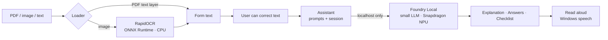

# Sahayak – Private, Offline AI Form Assistant on Snapdragon

> Sahayak (सहायक, "helper") explains bank, government and hospital forms in simple **Hindi or English**, answers questions about them, and builds a field checklist. Everything runs **on the laptop**, with the language model accelerated on the **Snapdragon Hexagon NPU**. No document ever leaves the device.

Built for the **Snapdragon® AI Lab Build & Present Challenge** (Qualcomm × Unstop), targeting Snapdragon-powered HP PCs.

<!-- Replace with your own screenshot / GIF recorded on your Snapdragon laptop -->


---

## The problem

Everyday forms, such as bank KYC, government schemes, insurance claims and hospital admission, are usually in English or legal language. Many people cannot read them comfortably. So they hand Aadhaar, PAN and medical papers to agents, or upload them to cloud apps. Mistakes cause rejections and repeat visits. Sahayak gives them a private helper that works even with no internet.

## Features and status

| Feature | Status |
|---|---|
| Open a form as a PDF (text layer), image (OCR) or text file | ✅ Implemented |
| On-device OCR (RapidOCR, ONNX Runtime) | ✅ Implemented |
| Plain-language explanation in English or Hindi | ✅ Implemented |
| Follow-up questions about the form | ✅ Implemented |
| Field checklist with required fields and documents to keep ready | ✅ Implemented |
| Edit the OCR text before asking (fix scan mistakes) | ✅ Implemented |
| Read the answer aloud (Windows speech, offline) | ✅ Implemented (optional) |
| One-click **Wipe session**; nothing written to disk | ✅ Implemented |
| Privacy guard: refuses any non-localhost AI endpoint | ✅ Implemented |
| Voice questions (on-device Whisper) | 🚧 Planned |
| Webcam capture inside the app | 🚧 Planned (use the Windows Camera app to take a photo for now) |
| OCR on the NPU | 🚧 Planned (OCR currently runs on the CPU) |

## Architecture



- **LLM on the NPU:** [Microsoft Foundry Local](https://learn.microsoft.com/en-us/windows/ai/foundry-local/get-started) serves models through an OpenAI-compatible API on `localhost`. When you pass a model alias, it picks the best variant for the hardware, which is a **QNN (NPU) variant on Snapdragon** when the catalogue has one.
- **Why the NPU:** privacy (no cloud), offline use, zero per-query cost, and lower power than running the model on the CPU. That matters for all-day help-desk use.
- **Security:** document text is treated as untrusted data. It is fenced in `<document>` tags, and the model is told to ignore instructions inside it. Logs record timings only, never document content.

## Requirements

- A Snapdragon X-series Windows 11 laptop (e.g., HP OmniBook)
- **Python 3.11 or 3.12, ARM64 build** from [python.org](https://www.python.org/downloads/windows/)
- [Foundry Local](https://learn.microsoft.com/en-us/windows/ai/foundry-local/get-started)

## Setup

```powershell
# 1. Install and start the on-device model (the first run downloads it; afterwards it works offline)
winget install Microsoft.FoundryLocal
foundry model run phi-3.5-mini        # type /exit after the test chat; the service keeps running
foundry service status                 # shows the local endpoint URL

# 2. Get the code
git clone https://github.com/<your-username>/sahayak.git
cd sahayak
python -c "import platform; print(platform.machine())"   # must print ARM64
python -m venv .venv
.\.venv\Scripts\Activate.ps1
python -m pip install --upgrade pip
pip install -r requirements.txt

# 3. Check everything
python scripts/check_env.py

# 4. Run
python app.py
```

Sahayak finds the Foundry Local endpoint automatically. To choose a different model or endpoint, copy `.env.example` and set the variables in your shell, for example `$env:SAHAYAK_LLM_MODEL="qwen2.5-1.5b"`. Run `foundry model list` to see which models have an NPU variant on your device.

## Using it

1. Click **Open form…** and pick a PDF, photo or `samples/sample_kyc_form.png`.
2. Fix any OCR mistakes in the left pane.
3. Choose **English** or **Hindi**, then click **Explain**.
4. Type a question (e.g., "What is a nominee?") and press **Ask**.
5. Click **Field checklist** to see what to fill, and **Read aloud** to hear the last answer.
6. Click **Wipe session** when done, which is important on shared laptops.

## Verifying NPU use

1. `python scripts/check_env.py` prints the selected model id. On Snapdragon, Foundry Local NPU variants include `qnn` or `npu` in the id.
2. Open **Task Manager → Performance → NPU** and click **Explain**. NPU utilisation should rise.
3. For a CPU baseline, run a CPU variant of the same model and compare the numbers in the benchmark.

## Benchmarks

```powershell
python benchmarks/benchmark.py --runs 5
python benchmarks/benchmark.py --runs 5 --language Hindi
```

The script saves JSON to `benchmarks/results/` and prints a Markdown table. Results are recorded in [docs/BENCHMARKS.md](docs/BENCHMARKS.md).

> Only numbers measured on real hardware are reported there. Nothing is estimated.

## Tests

```powershell
pip install -r requirements-dev.txt
python -m pytest -q
```

The tests need no model or NPU. They cover the privacy guard, model selection, document loading and errors, OCR line ordering, prompt fencing, JSON parsing, session wipe, bounded history, and an HTTP round-trip against a fake local server.

Manual test checklist:
- A clear photo, a blurred photo, and a digital PDF
- A scanned PDF, which should show a clear message asking for an image
- An unsupported file type
- Wi-Fi off, which should work exactly the same
- Foundry service stopped, which should show a clear error without freezing
- Hindi output renders correctly

## Troubleshooting

| Symptom | Fix |
|---|---|
| `No local LLM endpoint found` | Run `foundry model run phi-3.5-mini`, then `foundry service status`. Or set `SAHAYAK_LLM_BASE_URL` to the URL it prints. |
| `pip install rapidocr_onnxruntime` fails on ARM64 | Some of its dependencies (opencv-python, shapely, pyclipper) may not publish Windows ARM64 wheels for your Python version. You can still use digital PDFs and text files. Alternatively, install community ARM64 wheels, or use x64 Python (emulated) for OCR only. |
| `Refusing non-local LLM endpoint` | This is working as intended: Sahayak only talks to `localhost`. |
| Hindi text shows boxes | Make sure the Nirmala UI font is present, which is the default on Windows 10 and 11. |
| Read aloud is greyed out | Run `pip install pyttsx3`. For Hindi speech, add a Hindi voice in *Settings → Time & language → Speech*. |
| Slow first answer | The first call loads the model. Later calls are faster. |

## Project structure

```
sahayak/
├── app.py                 # Tkinter desktop app
├── sahayak/
│   ├── config.py          # settings from environment variables
│   ├── llm.py             # localhost-only OpenAI-compatible client, Foundry discovery
│   ├── ocr.py             # RapidOCR + reading-order line grouping
│   ├── documents.py       # PDF / image / text loading and validation
│   ├── prompts.py         # prompt templates, document fencing
│   ├── assistant.py       # explain / ask / checklist, session + wipe
│   └── tts.py             # optional offline read-aloud
├── scripts/check_env.py   # readiness check
├── benchmarks/benchmark.py
├── samples/               # fictional demo form (txt + png)
├── tests/                 # pytest suite
└── docs/BENCHMARKS.md
```

## Roadmap

1. Voice questions with on-device Whisper
2. Webcam capture inside the app
3. OCR models from Qualcomm AI Hub on the NPU
4. More Indian languages
5. A library of form templates
6. A signed installer (.exe) and kiosk mode

## Responsible use

Sahayak explains forms. It never submits anything, and the user always decides and signs. Answers come from a small local model and can be wrong, so important details should be confirmed with the issuing office. The sample form is fictional.

## License

MIT (see [LICENSE](LICENSE)).
